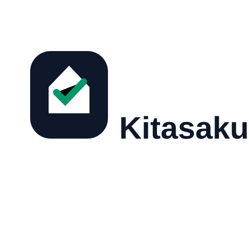
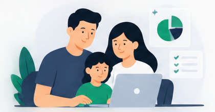
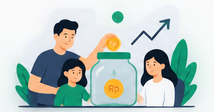

  

<h3 align="center">Family money, planned together.</h3>

  Kitasaku helps a household give every rupiah a job before the month begins — 
  and see, together, whether the plan held.

  
  
  

---

## Why Kitasaku

Most expense trackers tell you where the money went. By then the month is over.

Kitasaku starts on payday. You and your partner open a new cycle, the routine bills fill
themselves in, and you decide together where the rest goes — until nothing is left
unassigned. Through the month you tick plans off as they are paid. At the end, you compare
the plan with your real bank balance and close the cycle with a clean slate.

One household. Two phones. The same numbers on both.

## What you can do

**Plan every payday — Siklus.**
Open a cycle and your recurring bills, instalments and savings are already there. Kitasaku
shows which part of the plan your bank account has to cover and which part goes on a credit
card, and warns you early if the plan needs more than you have.

**Give every rupiah a job.**
Allocate income to bills, debt, savings and daily needs until the unassigned amount reaches
Rp 0. Kitasaku tells you where the remainder lands while you type, not after you save.

**Pay what you planned.**
Every plan becomes a checklist item. Confirm payments one by one or several at once, and
share the summary with your partner. Each commitment shows what it actually cost against
what you planned.

**Keep debts under control — Kewajiban.**
Track loans, instalments and money owed to family or friends. Pay the next instalment, any
amount you choose, or settle the whole debt in one step. See at a glance what falls due in
the next two weeks.

**Close the month honestly.**
Compare the cycle with your real bank balance. Any difference is recorded, not hidden, and
leftover money can be swept back to your main account before the next cycle starts.

**Cards and cash, without double counting.**
Spend on a credit card or with cash and it still shows up in the month's history — but it
never inflates your cash figures, and the card bill is counted once, when you pay it.

**Watch savings and assets grow.**
Keep investment and savings positions in one place, record top-ups and valuations, and see
the year's picture in Insight & Aset.

**Look back with confidence — Riwayat.**
Browse earlier cycles, see each category against its budget, including overspend beyond
100%, and keep cancelled cycles as a readable archive.

## Built for the way families handle money

- **Shared from day one.** Sign in with Google, create a family space, and invite your
  partner with a short code sent over WhatsApp. Changes appear on both phones in real time.
- **Made for Indonesia.** Rupiah everywhere, Indonesian throughout, and the words families
  already use: Siklus, Kewajiban, Tagihan, Tabungan.
- **Nothing quietly disappears.** Payments are never reversed and money records are never
  deleted. Cancelling a transaction or a whole cycle keeps the record, the reason, and who
  did it.
- **Private to your household.** Every record belongs to one family space, and only its
  members can read or change it.
- **Every figure says what it counts.** Each total on screen states which accounts and
  which transactions it includes, so two numbers never contradict each other silently.

## Availability

Kitasaku **1.0** is available for **Android**. iOS is not released yet.

## More

- [What's new](CHANGELOG.md)
- [Development guide](docs/DEVELOPMENT.md) — stack, project structure, domain rules and
  database migrations
- [License](LICENSE)
